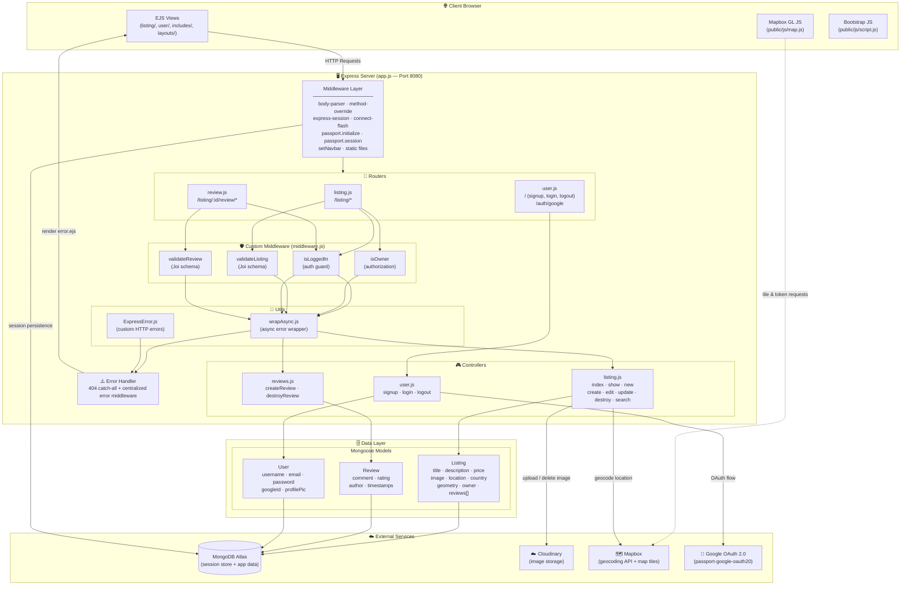
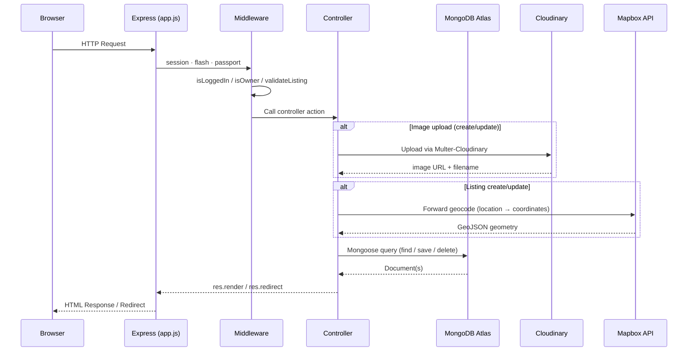
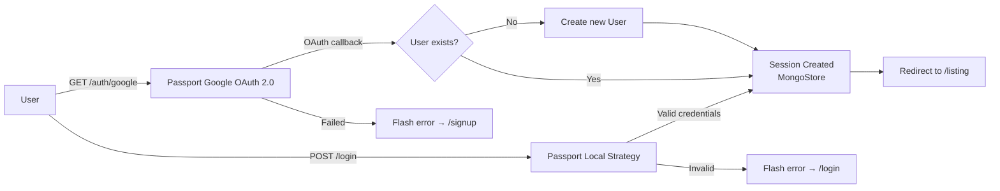

# 🏠 bookMyBrix

**bookMyBrix** is a full-stack property listing web application built with Node.js and Express. Users can browse, create, edit, and review property listings with integrated map visualization. It supports both local and Google OAuth authentication.

---

## ✨ Features

- 🔐 **Dual Authentication** — Local (username/password) and Google OAuth 2.0
- 🏘️ **Property Listings** — Full CRUD (Create, Read, Update, Delete) for listings
- 🗺️ **Mapbox Integration** — Geocoding and interactive map on each listing page
- ⭐ **Review System** — Authenticated users can post and delete reviews (1–5 star rating)
- 📸 **Image Uploads** — Images stored on Cloudinary via Multer
- 🔒 **Authorization** — Only the listing owner can edit or delete their listing
- 🔍 **Search** — Search listings by location, country, or max price
- 💬 **Flash Messages** — Success/error feedback on every user action
- 🗄️ **Session Persistence** — Sessions stored in MongoDB via `connect-mongo`
- ✅ **Joi Validation** — Server-side schema validation for all form inputs

---

## 🛠️ Tech Stack

| Layer         | Technology                                    |
|---------------|-----------------------------------------------|
| Runtime       | Node.js v22                                   |
| Framework     | Express.js v4                                 |
| Database      | MongoDB Atlas (via Mongoose)                  |
| Templating    | EJS + ejs-mate (layouts)                      |
| Auth          | Passport.js (Local + Google OAuth 2.0)        |
| File Uploads  | Multer + Cloudinary                           |
| Maps          | Mapbox GL JS + Mapbox Geocoding SDK           |
| Validation    | Joi                                           |
| Session Store | connect-mongo                                 |
| Styling       | Bootstrap 5 + Custom CSS                     |

---

## 🏗️ Architecture Diagram



---

## 📁 Project Structure

```
bookMyBrix-main/
│
├── app.js                  # Entry point: Express config, middleware, routes, DB connection
├── middleware.js           # Custom middleware: isLoggedIn, isOwner, validateListing/Review, setNavbar
├── cloudConfig.js          # Cloudinary & multer-storage-cloudinary setup
├── schema.js               # Joi validation schemas for listings & reviews
│
├── models/
│   ├── listing.js          # Mongoose schema: Listing (with cascade delete for reviews)
│   ├── review.js           # Mongoose schema: Review
│   └── user.js             # Mongoose schema: User (passport-local-mongoose plugin)
│
├── router/
│   ├── listing.js          # Express Router: /listing routes (CRUD + search)
│   ├── review.js           # Express Router: /listing/:id/review routes
│   └── user.js             # Express Router: /signup, /login, /logout, /auth/google
│
├── controllers/
│   ├── listing.js          # Listing business logic (index, create, update, delete, search)
│   ├── reviews.js          # Review business logic (create, delete)
│   └── user.js             # User business logic (signup, login, logout)
│
├── views/
│   ├── layouts/
│   │   └── boilerplate.ejs # Base layout (navbar, flash messages, footer)
│   ├── includes/
│   │   ├── navbar.ejs      # Navigation bar (auth-aware)
│   │   ├── footer.ejs      # Site footer
│   │   └── flash.ejs       # Flash message display
│   ├── listing/
│   │   ├── index.ejs       # All listings / search results
│   │   ├── show.ejs        # Single listing detail + map + reviews
│   │   ├── new.ejs         # Create new listing form
│   │   └── edit.ejs        # Edit listing form
│   ├── user/
│   │   ├── login.ejs       # Login page
│   │   └── signIn.ejs      # Signup page
│   └── error.ejs           # Error page
│
├── public/
│   ├── css/
│   │   ├── style.css       # Global styles
│   │   └── review.css      # Review-specific styles
│   ├── js/
│   │   ├── map.js          # Mapbox GL JS map initialization
│   │   └── script.js       # Bootstrap validation & UI scripts
│   └── images/             # Static fallback images
│
├── utils/
│   ├── wrapAsync.js        # Wraps async route handlers for error forwarding
│   └── ExpressError.js     # Custom error class with status code
│
└── init/
    ├── data.js             # Seed data for listings
    └── index.js            # DB seeding script
```

---

## 🔄 Request Lifecycle



---

## 🔐 Authentication Flow



---

## 🚀 Getting Started

### Prerequisites

- Node.js v22+
- MongoDB Atlas account
- Cloudinary account
- Mapbox account
- Google Cloud OAuth credentials (optional)

### Installation

1. **Clone the repository**
   ```bash
   git clone https://github.com/Junaidk007/BookMyBrix-main
   cd bookMyBrix
   ```

2. **Install dependencies**
   ```bash
   npm install
   ```

3. **Create a `.env` file** in the project root:
   ```env
   # MongoDB
   ATLASDB_URL=mongodb+srv://<user>:<password>@cluster.mongodb.net/bookmybrix

   # Session
   MY_SECRET=your_session_secret

   # Cloudinary
   CLOUD_NAME=your_cloud_name
   CLOUD_API_KEY=your_cloud_api_key
   CLOUD_API_SECRET=your_cloud_api_secret

   # Mapbox
   MAP_TOKEN=your_mapbox_access_token

   # Google OAuth (optional)
   GOOGLE_CLIENT_ID=your_google_client_id
   GOOGLE_CLIENT_SECRET=your_google_client_secret
   GOOGLE_CALLBACK_URL=http://localhost:8080/auth/google/callback
   ```

4. **(Optional) Seed the database**
   ```bash
   node init/index.js
   ```

5. **Start the server**
   ```bash
   node app.js
   ```

6. Open your browser at `http://localhost:8080/listing`

---

## 📡 API Routes

### Listings

| Method   | Route                  | Auth Required | Description                        |
|----------|------------------------|---------------|------------------------------------|
| `GET`    | `/listing`             | ❌             | Browse all listings                |
| `GET`    | `/listing/search`      | ❌             | Search by location/country/price   |
| `GET`    | `/listing/new`         | ✅             | Show create listing form           |
| `POST`   | `/listing`             | ✅             | Create a new listing               |
| `GET`    | `/listing/:id`         | ❌             | Show a single listing + map        |
| `GET`    | `/listing/:id/edit`    | ✅ (owner)     | Show edit form                     |
| `PUT`    | `/listing/:id`         | ✅ (owner)     | Update a listing                   |
| `DELETE` | `/listing/:id`         | ✅ (owner)     | Delete a listing                   |

### Reviews

| Method   | Route                            | Auth Required | Description          |
|----------|----------------------------------|---------------|----------------------|
| `POST`   | `/listing/:id/review`            | ✅             | Add a review         |
| `DELETE` | `/listing/:id/review/:reviewId`  | ✅ (author)    | Delete a review      |

### Users

| Method | Route                    | Description                     |
|--------|--------------------------|---------------------------------|
| `GET`  | `/signup`                | Show signup page                |
| `POST` | `/signup`                | Register a new user             |
| `GET`  | `/login`                 | Show login page                 |
| `POST` | `/login`                 | Authenticate with local strategy|
| `GET`  | `/logout`                | Logout and destroy session      |
| `GET`  | `/auth/google`           | Initiate Google OAuth           |
| `GET`  | `/auth/google/callback`  | Google OAuth callback           |

---

## 🔑 Environment Variables Reference

| Variable              | Description                              |
|-----------------------|------------------------------------------|
| `NODE_ENV`            | Set to `production` to skip dotenv       |
| `ATLASDB_URL`         | MongoDB Atlas connection string          |
| `MY_SECRET`           | Secret for session encryption            |
| `CLOUD_NAME`          | Cloudinary cloud name                    |
| `CLOUD_API_KEY`       | Cloudinary API key                       |
| `CLOUD_API_SECRET`    | Cloudinary API secret                    |
| `MAP_TOKEN`           | Mapbox public access token               |
| `GOOGLE_CLIENT_ID`    | Google OAuth client ID                   |
| `GOOGLE_CLIENT_SECRET`| Google OAuth client secret               |
| `GOOGLE_CALLBACK_URL` | Google OAuth redirect URI                |

---

## 📄 License

This project is licensed under the **ISC License**.

